# Apêndice B: prints das ferramentas automáticas

Capturas de tela dos relatórios do WAVE e do axe DevTools. Clique em uma imagem para abri-la ampliada em outra aba. Os números estão resumidos em [Avaliação automática](avaliacao-automatica.md).

## WAVE (Fig. B1 a B21)

<figure class="rel-fig" id="fig-b1" markdown="1">
[{ loading=lazy }](../../assets/images/avaliacao-detran/fig-b1.webp){ target=_blank rel=noopener }
<figcaption markdown="1">**Fig. B1** · WAVE, E1 – Página inicial</figcaption>
</figure>

<figure class="rel-fig" id="fig-b2" markdown="1">
[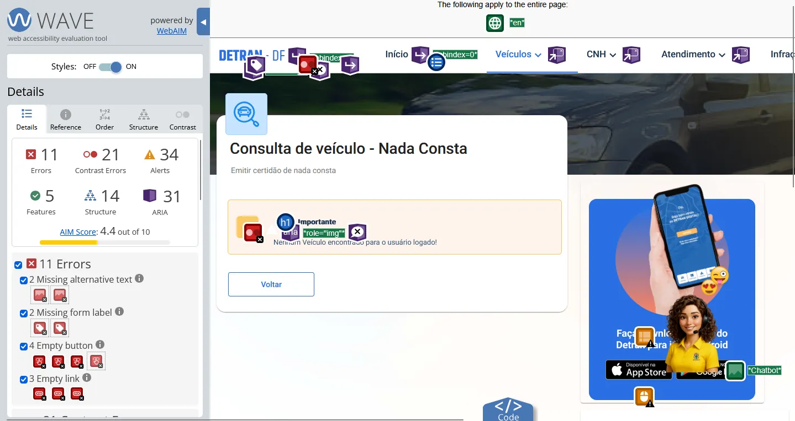{ loading=lazy }](../../assets/images/avaliacao-detran/fig-b2.webp){ target=_blank rel=noopener }
<figcaption markdown="1">**Fig. B2** · WAVE, E2 – Consulta de Nada Consta do Veículo</figcaption>
</figure>

<figure class="rel-fig" id="fig-b3" markdown="1">
[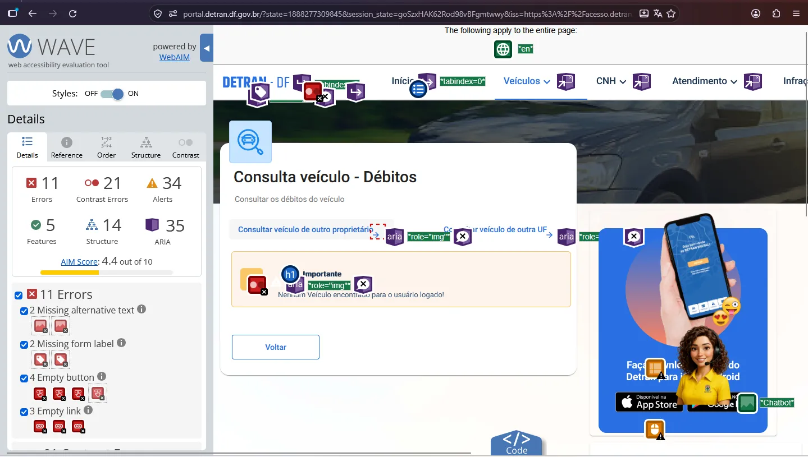{ loading=lazy }](../../assets/images/avaliacao-detran/fig-b3.webp){ target=_blank rel=noopener }
<figcaption markdown="1">**Fig. B3** · WAVE, E3 – Consulta de Débito do Veículo</figcaption>
</figure>

<figure class="rel-fig" id="fig-b4" markdown="1">
[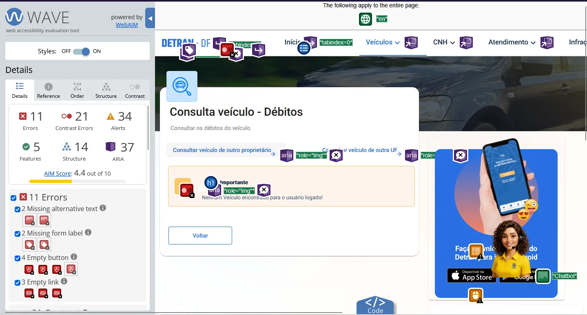{ loading=lazy }](../../assets/images/avaliacao-detran/fig-b4.webp){ target=_blank rel=noopener }
<figcaption markdown="1">**Fig. B4** · WAVE, E4 – Emissão de CRLV-e</figcaption>
</figure>

<figure class="rel-fig" id="fig-b5" markdown="1">
[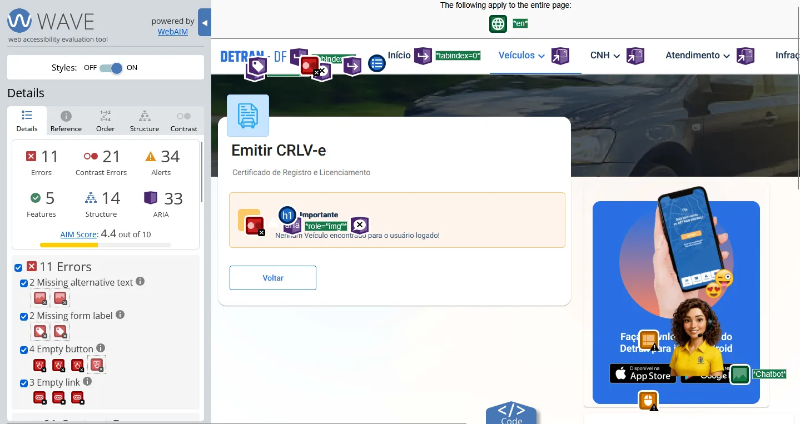{ loading=lazy }](../../assets/images/avaliacao-detran/fig-b5.webp){ target=_blank rel=noopener }
<figcaption markdown="1">**Fig. B5** · WAVE, E5 – Emissão de ATPV-e</figcaption>
</figure>

<figure class="rel-fig" id="fig-b6" markdown="1">
[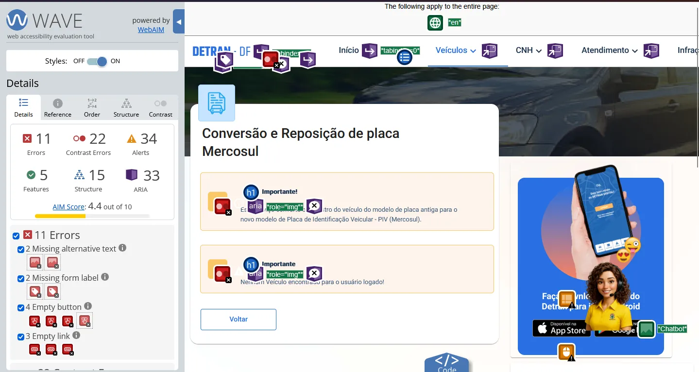{ loading=lazy }](../../assets/images/avaliacao-detran/fig-b6.webp){ target=_blank rel=noopener }
<figcaption markdown="1">**Fig. B6** · WAVE, E6 – Emissão de Placa de Identificação do Veículo</figcaption>
</figure>

<figure class="rel-fig" id="fig-b7" markdown="1">
[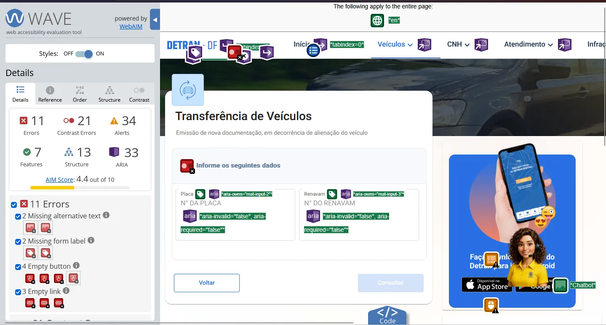{ loading=lazy }](../../assets/images/avaliacao-detran/fig-b7.webp){ target=_blank rel=noopener }
<figcaption markdown="1">**Fig. B7** · WAVE, E7 – Transferência de Veículo</figcaption>
</figure>

<figure class="rel-fig" id="fig-b8" markdown="1">
[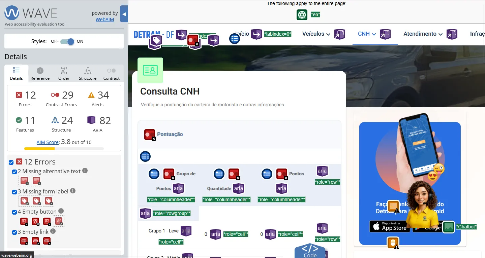{ loading=lazy }](../../assets/images/avaliacao-detran/fig-b8.webp){ target=_blank rel=noopener }
<figcaption markdown="1">**Fig. B8** · WAVE, E8 – Consultar CNH</figcaption>
</figure>

<figure class="rel-fig" id="fig-b9" markdown="1">
[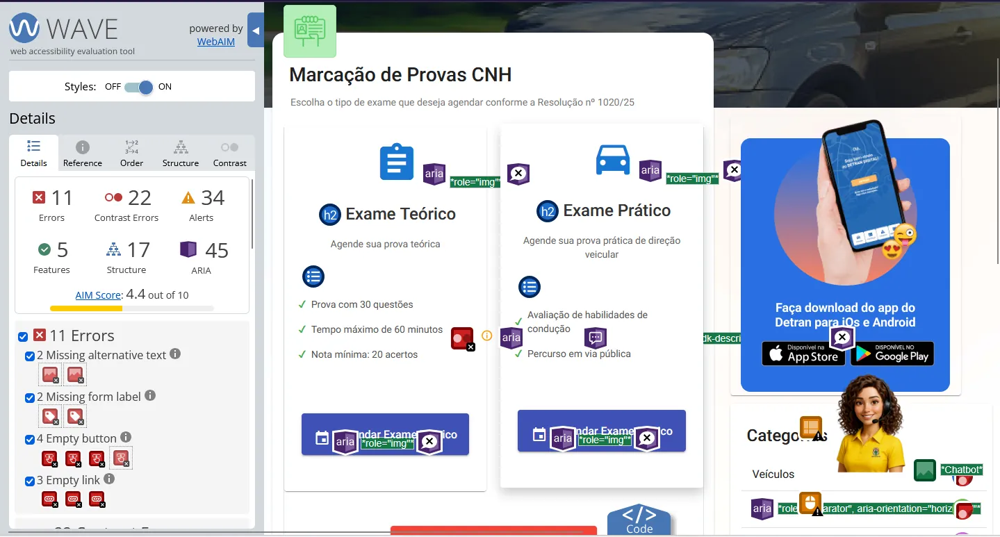{ loading=lazy }](../../assets/images/avaliacao-detran/fig-b9.webp){ target=_blank rel=noopener }
<figcaption markdown="1">**Fig. B9** · WAVE, E9 – Marcação de Provas CNH - Teórico e Prático</figcaption>
</figure>

<figure class="rel-fig" id="fig-b10" markdown="1">
[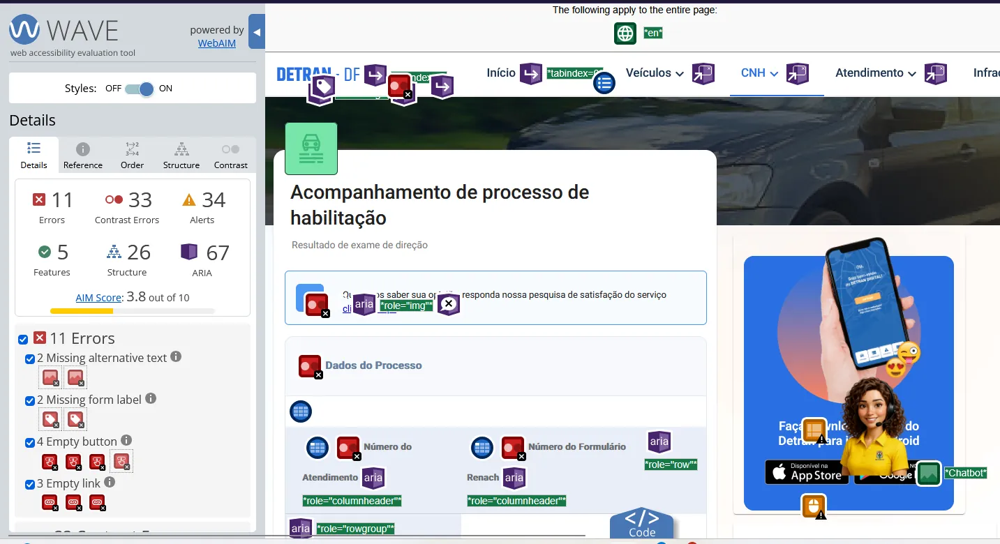{ loading=lazy }](../../assets/images/avaliacao-detran/fig-b10.webp){ target=_blank rel=noopener }
<figcaption markdown="1">**Fig. B10** · WAVE, E10 – Acompanhamento de Processo de Habilitação</figcaption>
</figure>

<figure class="rel-fig" id="fig-b11" markdown="1">
[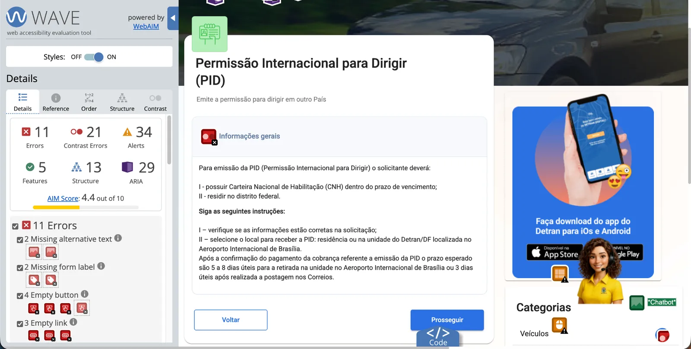{ loading=lazy }](../../assets/images/avaliacao-detran/fig-b11.webp){ target=_blank rel=noopener }
<figcaption markdown="1">**Fig. B11** · WAVE, E11 – Permissão Internacional para Dirigir</figcaption>
</figure>

<figure class="rel-fig" id="fig-b12" markdown="1">
[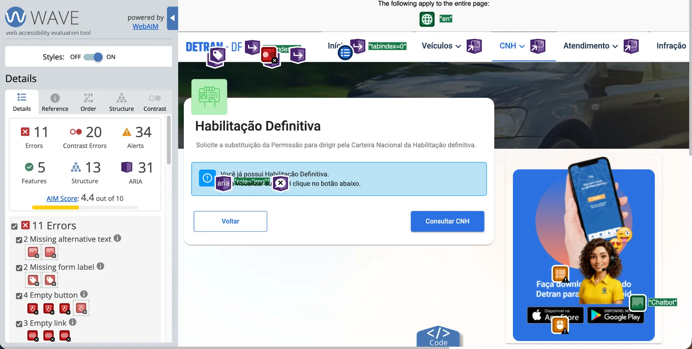{ loading=lazy }](../../assets/images/avaliacao-detran/fig-b12.webp){ target=_blank rel=noopener }
<figcaption markdown="1">**Fig. B12** · WAVE, E12 – CNH Definitiva</figcaption>
</figure>

<figure class="rel-fig" id="fig-b13" markdown="1">
[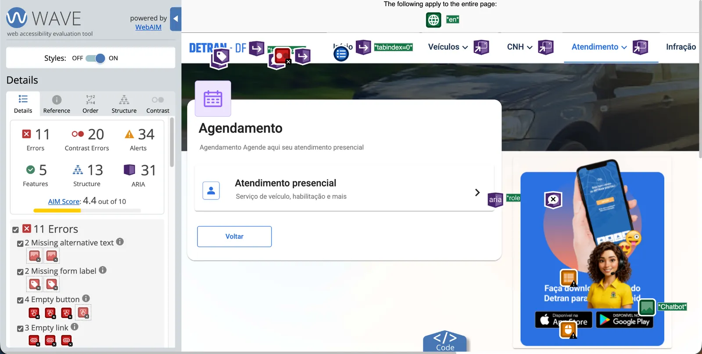{ loading=lazy }](../../assets/images/avaliacao-detran/fig-b13.webp){ target=_blank rel=noopener }
<figcaption markdown="1">**Fig. B13** · WAVE, E13 – Agendamento Presencial</figcaption>
</figure>

<figure class="rel-fig" id="fig-b14" markdown="1">
[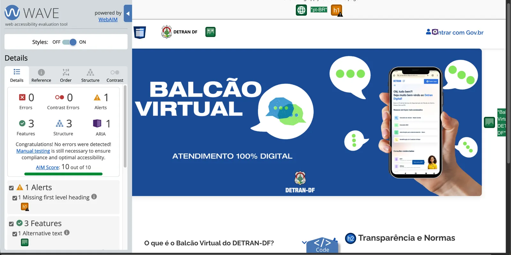{ loading=lazy }](../../assets/images/avaliacao-detran/fig-b14.webp){ target=_blank rel=noopener }
<figcaption markdown="1">**Fig. B14** · WAVE, E14 – Balcão Virtual</figcaption>
</figure>

<figure class="rel-fig" id="fig-b15" markdown="1">
[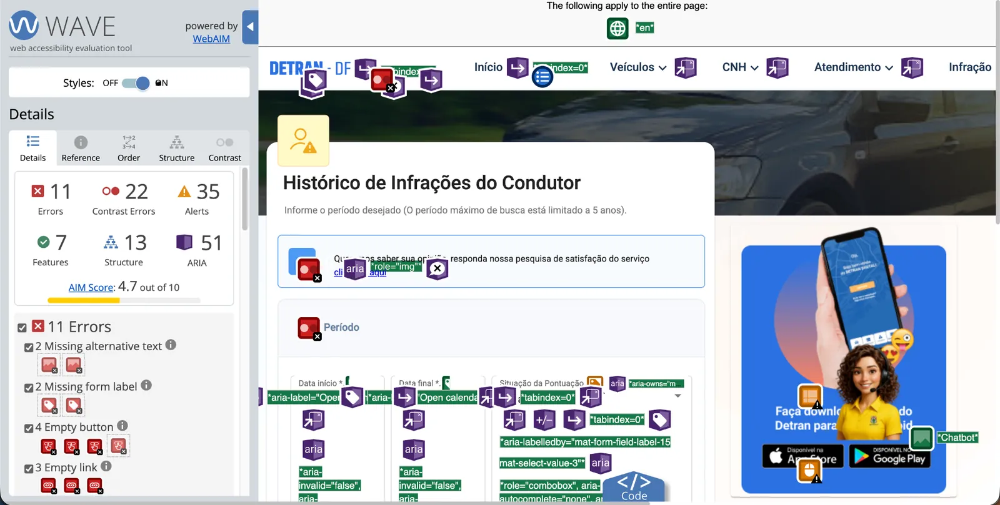{ loading=lazy }](../../assets/images/avaliacao-detran/fig-b15.webp){ target=_blank rel=noopener }
<figcaption markdown="1">**Fig. B15** · WAVE, E15 – Consulta de Infrações por Condutor</figcaption>
</figure>

<figure class="rel-fig" id="fig-b16" markdown="1">
[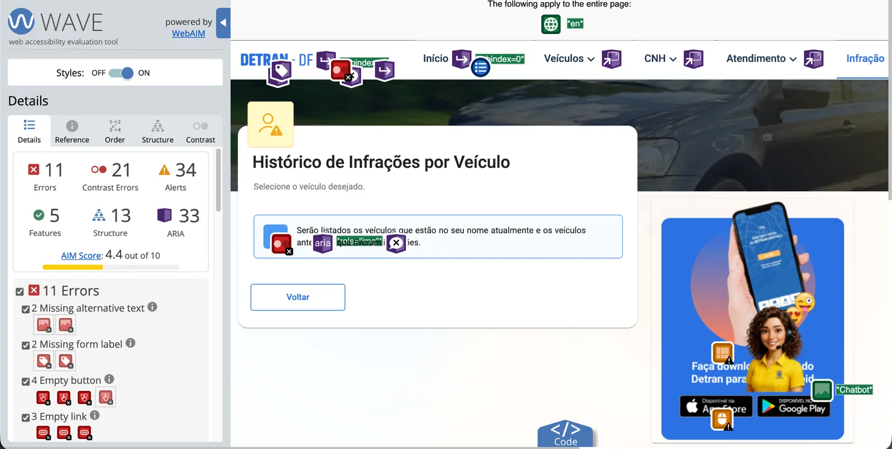{ loading=lazy }](../../assets/images/avaliacao-detran/fig-b16.webp){ target=_blank rel=noopener }
<figcaption markdown="1">**Fig. B16** · WAVE, E16 – Histórico de Infrações por Veículo</figcaption>
</figure>

<figure class="rel-fig" id="fig-b17" markdown="1">
[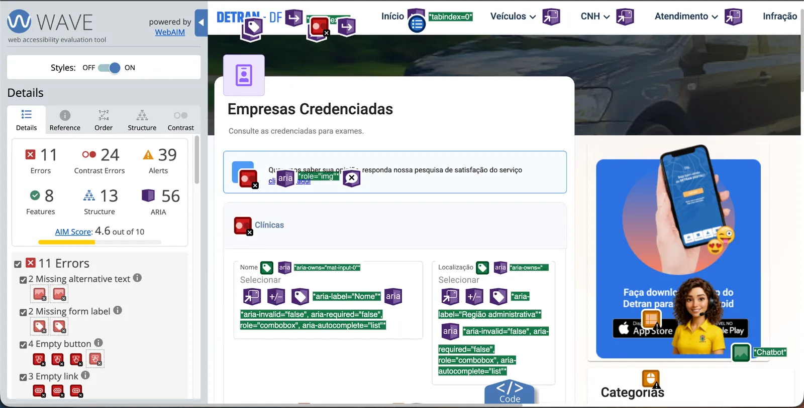{ loading=lazy }](../../assets/images/avaliacao-detran/fig-b17.webp){ target=_blank rel=noopener }
<figcaption markdown="1">**Fig. B17** · WAVE, E18 – Consultar Clínica</figcaption>
</figure>

<figure class="rel-fig" id="fig-b18" markdown="1">
[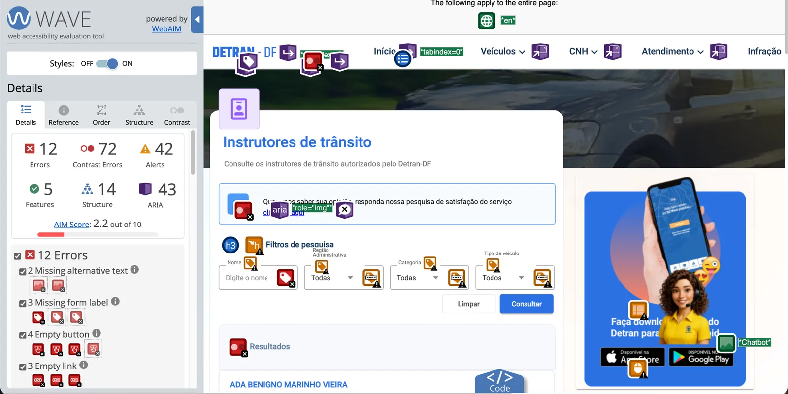{ loading=lazy }](../../assets/images/avaliacao-detran/fig-b18.webp){ target=_blank rel=noopener }
<figcaption markdown="1">**Fig. B18** · WAVE, E19 – Consultar Instrutores de Trânsito</figcaption>
</figure>

<figure class="rel-fig" id="fig-b19" markdown="1">
[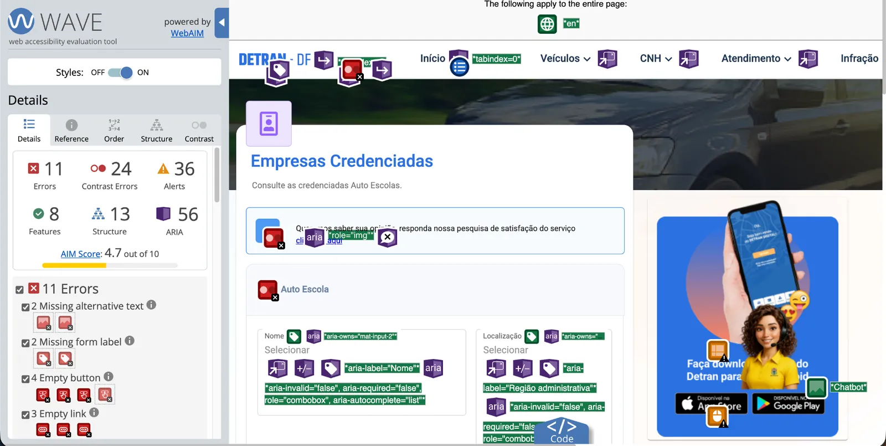{ loading=lazy }](../../assets/images/avaliacao-detran/fig-b19.webp){ target=_blank rel=noopener }
<figcaption markdown="1">**Fig. B19** · WAVE, E20 – Consultar Auto Escola</figcaption>
</figure>

<figure class="rel-fig" id="fig-b20" markdown="1">
[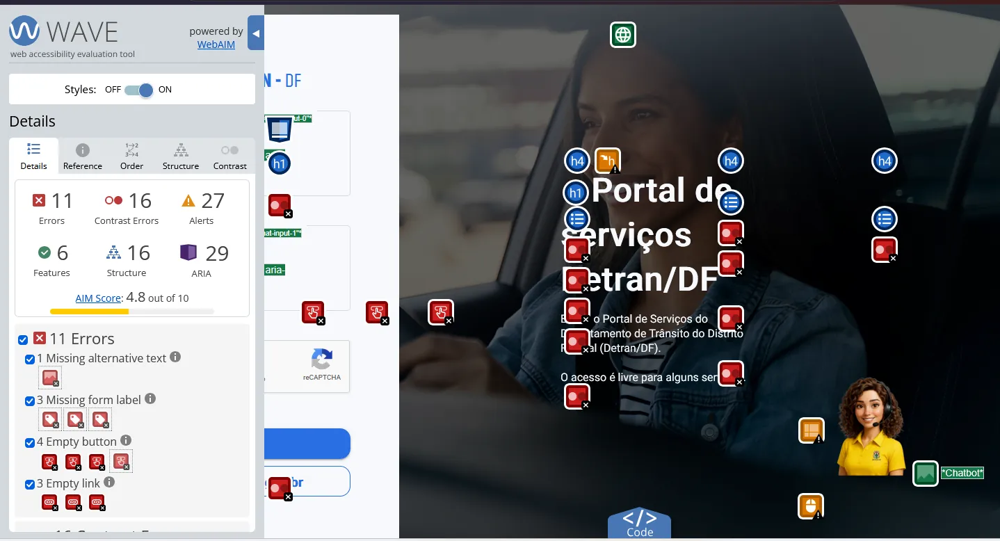{ loading=lazy }](../../assets/images/avaliacao-detran/fig-b20.webp){ target=_blank rel=noopener }
<figcaption markdown="1">**Fig. B20** · WAVE, E21 – Página de Login</figcaption>
</figure>

<figure class="rel-fig" id="fig-b21" markdown="1">
[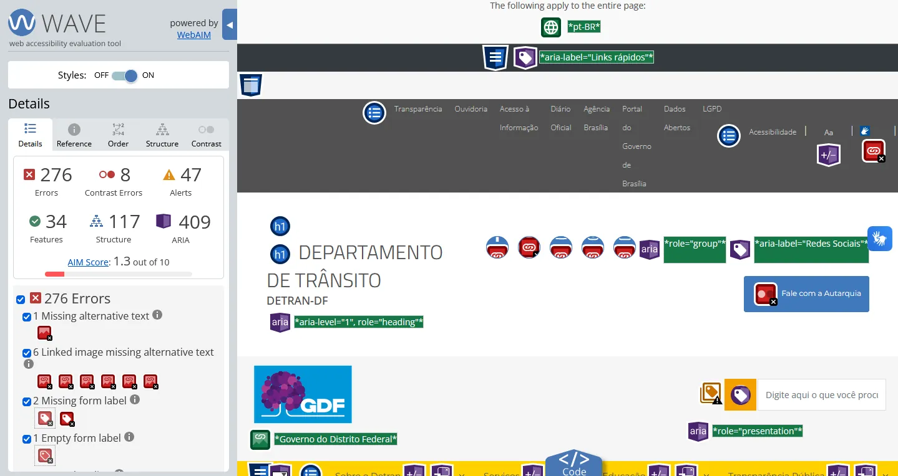{ loading=lazy }](../../assets/images/avaliacao-detran/fig-b21.webp){ target=_blank rel=noopener }
<figcaption markdown="1">**Fig. B21** · WAVE, E22 – Página Inicial 2</figcaption>
</figure>

## axe DevTools (Fig. B22 a B45)

<figure class="rel-fig" id="fig-b22" markdown="1">
[{ loading=lazy }](../../assets/images/avaliacao-detran/fig-b22.webp){ target=_blank rel=noopener }
<figcaption markdown="1">**Fig. B22** · axe DevTools, E1 – Página inicial</figcaption>
</figure>

<figure class="rel-fig" id="fig-b23" markdown="1">
[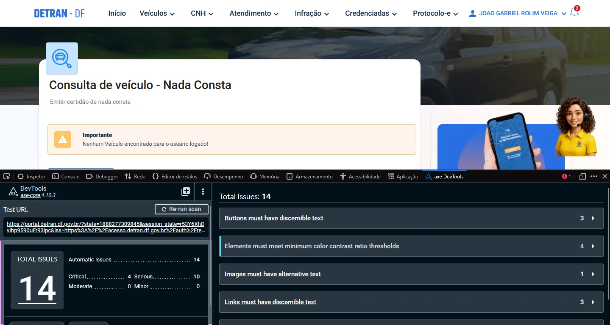{ loading=lazy }](../../assets/images/avaliacao-detran/fig-b23.webp){ target=_blank rel=noopener }
<figcaption markdown="1">**Fig. B23** · axe DevTools, E2 – Consulta de Nada Consta do Veículo</figcaption>
</figure>

<figure class="rel-fig" id="fig-b24" markdown="1">
[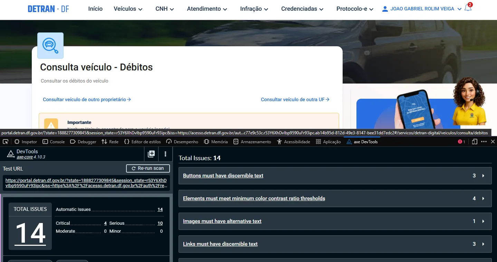{ loading=lazy }](../../assets/images/avaliacao-detran/fig-b24.webp){ target=_blank rel=noopener }
<figcaption markdown="1">**Fig. B24** · axe DevTools, E3 – Consulta de Débito do Veículo</figcaption>
</figure>

<figure class="rel-fig" id="fig-b25" markdown="1">
[{ loading=lazy }](../../assets/images/avaliacao-detran/fig-b25.webp){ target=_blank rel=noopener }
<figcaption markdown="1">**Fig. B25** · axe DevTools, E4 – Emissão de CRLV-e</figcaption>
</figure>

<figure class="rel-fig" id="fig-b26" markdown="1">
[{ loading=lazy }](../../assets/images/avaliacao-detran/fig-b26.webp){ target=_blank rel=noopener }
<figcaption markdown="1">**Fig. B26** · axe DevTools, E5 – Emissão de ATPV-e</figcaption>
</figure>

<figure class="rel-fig" id="fig-b27" markdown="1">
[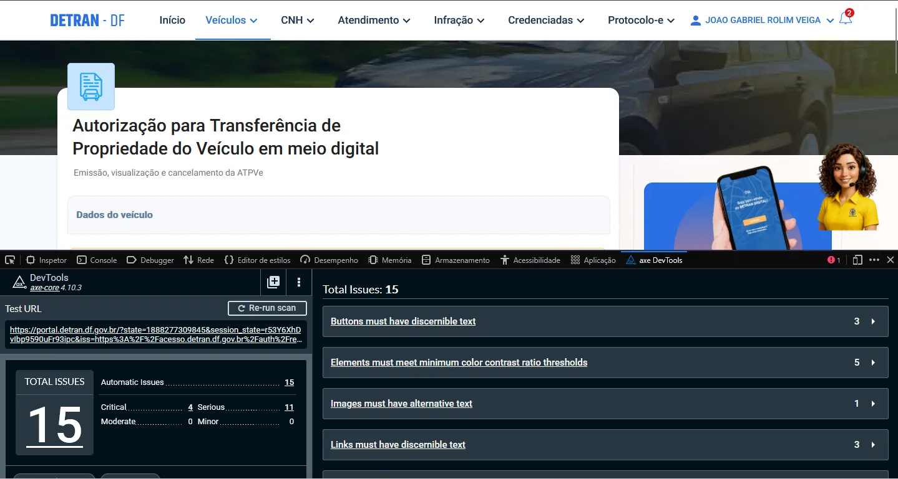{ loading=lazy }](../../assets/images/avaliacao-detran/fig-b27.webp){ target=_blank rel=noopener }
<figcaption markdown="1">**Fig. B27** · axe DevTools, E6 – Emissão de Placa de Identificação do Veículo</figcaption>
</figure>

<figure class="rel-fig" id="fig-b28" markdown="1">
[{ loading=lazy }](../../assets/images/avaliacao-detran/fig-b28.webp){ target=_blank rel=noopener }
<figcaption markdown="1">**Fig. B28** · axe DevTools, E7 – Transferência de Veículo</figcaption>
</figure>

<figure class="rel-fig" id="fig-b29" markdown="1">
[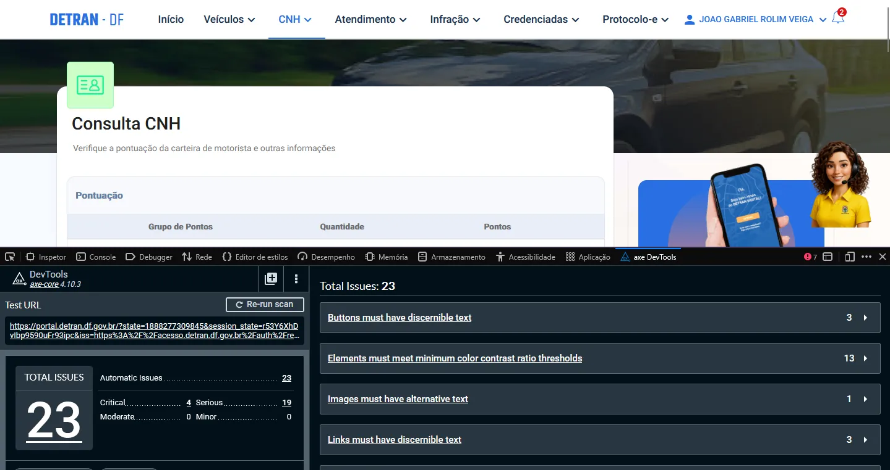{ loading=lazy }](../../assets/images/avaliacao-detran/fig-b29.webp){ target=_blank rel=noopener }
<figcaption markdown="1">**Fig. B29** · axe DevTools, E8 – Consultar CNH</figcaption>
</figure>

<figure class="rel-fig" id="fig-b30" markdown="1">
[{ loading=lazy }](../../assets/images/avaliacao-detran/fig-b30.webp){ target=_blank rel=noopener }
<figcaption markdown="1">**Fig. B30** · axe DevTools, E9 – Marcação de Provas CNH - Teórico e Prático (1/4)</figcaption>
</figure>

<figure class="rel-fig" id="fig-b31" markdown="1">
[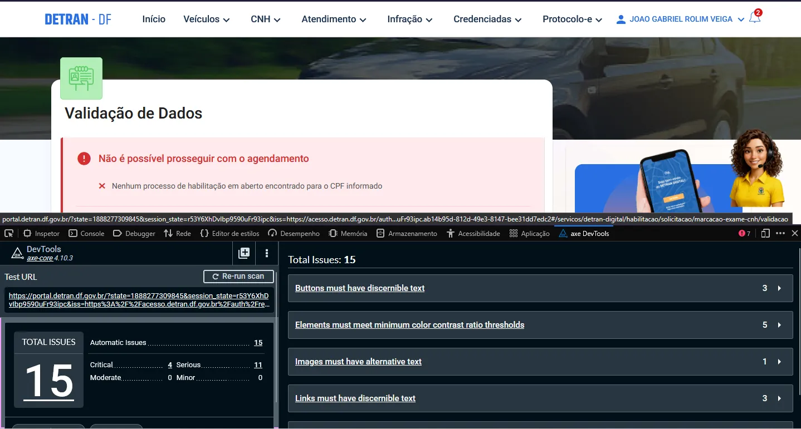{ loading=lazy }](../../assets/images/avaliacao-detran/fig-b31.webp){ target=_blank rel=noopener }
<figcaption markdown="1">**Fig. B31** · axe DevTools, E9 – Marcação de Provas CNH - Teórico e Prático (2/4)</figcaption>
</figure>

<figure class="rel-fig" id="fig-b32" markdown="1">
[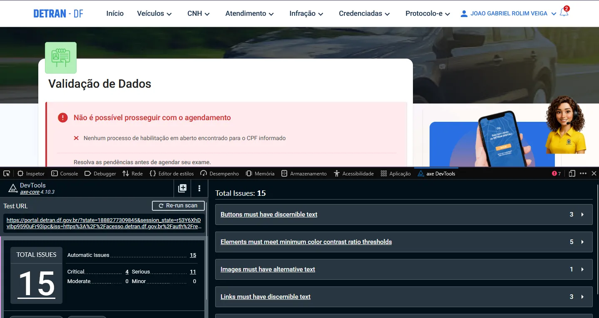{ loading=lazy }](../../assets/images/avaliacao-detran/fig-b32.webp){ target=_blank rel=noopener }
<figcaption markdown="1">**Fig. B32** · axe DevTools, E9 – Marcação de Provas CNH - Teórico e Prático (3/4)</figcaption>
</figure>

<figure class="rel-fig" id="fig-b33" markdown="1">
[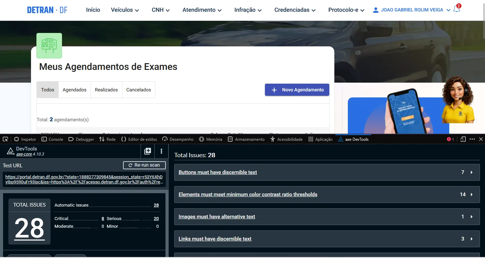{ loading=lazy }](../../assets/images/avaliacao-detran/fig-b33.webp){ target=_blank rel=noopener }
<figcaption markdown="1">**Fig. B33** · axe DevTools, E9 – Marcação de Provas CNH - Teórico e Prático (4/4)</figcaption>
</figure>

<figure class="rel-fig" id="fig-b34" markdown="1">
[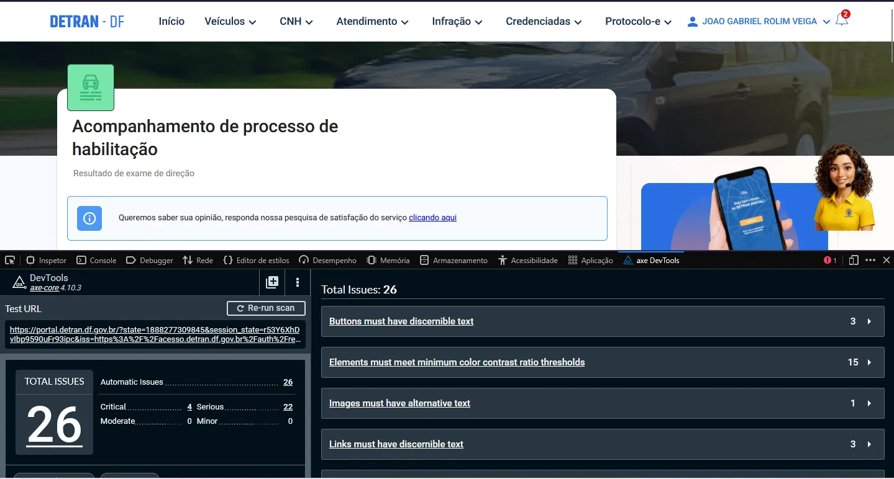{ loading=lazy }](../../assets/images/avaliacao-detran/fig-b34.webp){ target=_blank rel=noopener }
<figcaption markdown="1">**Fig. B34** · axe DevTools, E10 – Acompanhamento de Processo de Habilitação</figcaption>
</figure>

<figure class="rel-fig" id="fig-b35" markdown="1">
[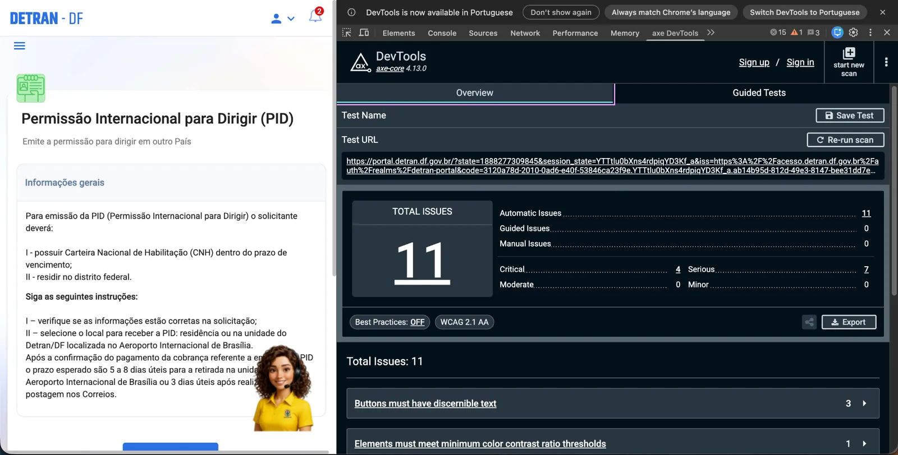{ loading=lazy }](../../assets/images/avaliacao-detran/fig-b35.webp){ target=_blank rel=noopener }
<figcaption markdown="1">**Fig. B35** · axe DevTools, E11 – Permissão Internacional para Dirigir</figcaption>
</figure>

<figure class="rel-fig" id="fig-b36" markdown="1">
[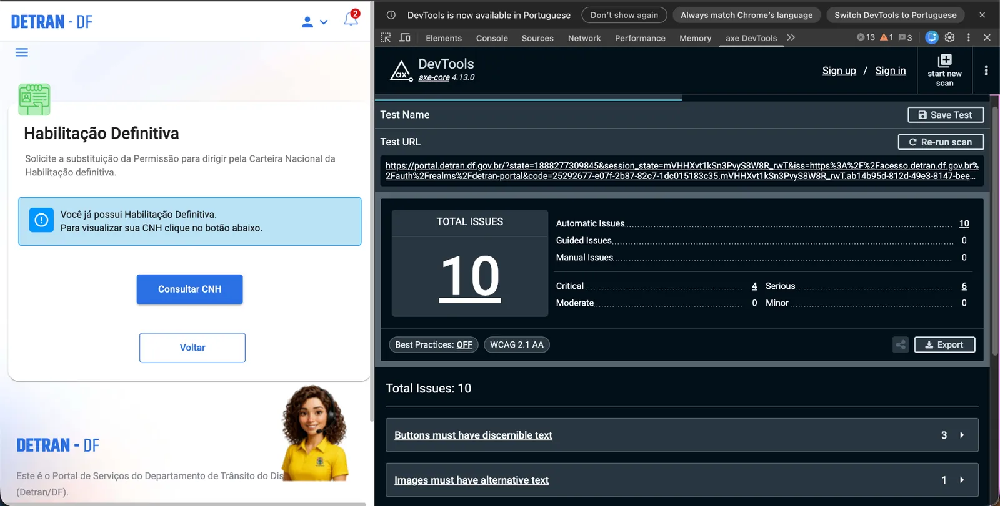{ loading=lazy }](../../assets/images/avaliacao-detran/fig-b36.webp){ target=_blank rel=noopener }
<figcaption markdown="1">**Fig. B36** · axe DevTools, E12 – CNH Definitiva</figcaption>
</figure>

<figure class="rel-fig" id="fig-b37" markdown="1">
[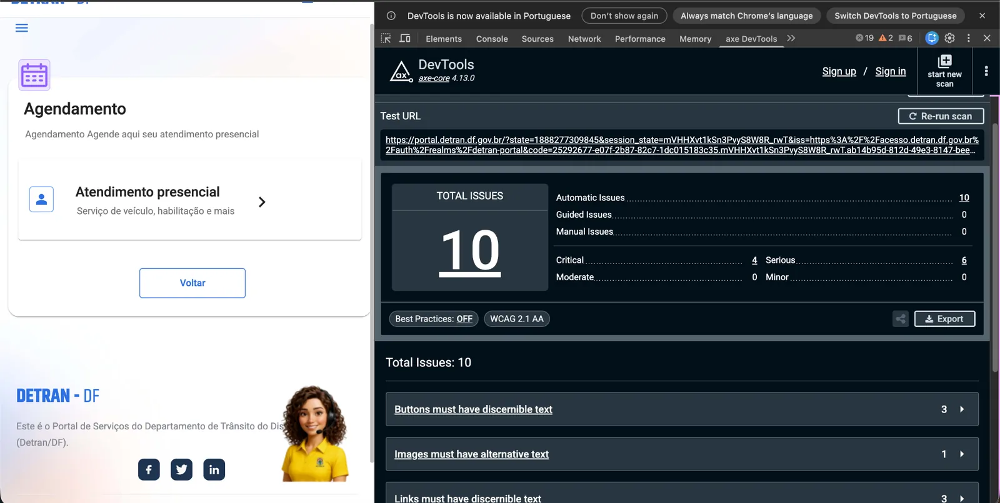{ loading=lazy }](../../assets/images/avaliacao-detran/fig-b37.webp){ target=_blank rel=noopener }
<figcaption markdown="1">**Fig. B37** · axe DevTools, E13 – Agendamento Presencial</figcaption>
</figure>

<figure class="rel-fig" id="fig-b38" markdown="1">
[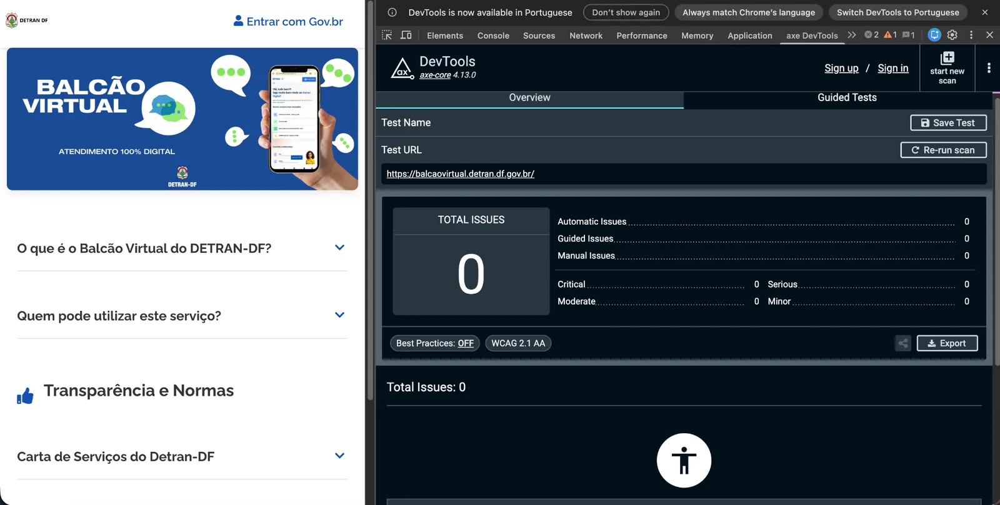{ loading=lazy }](../../assets/images/avaliacao-detran/fig-b38.webp){ target=_blank rel=noopener }
<figcaption markdown="1">**Fig. B38** · axe DevTools, E14 – Balcão Virtual</figcaption>
</figure>

<figure class="rel-fig" id="fig-b39" markdown="1">
[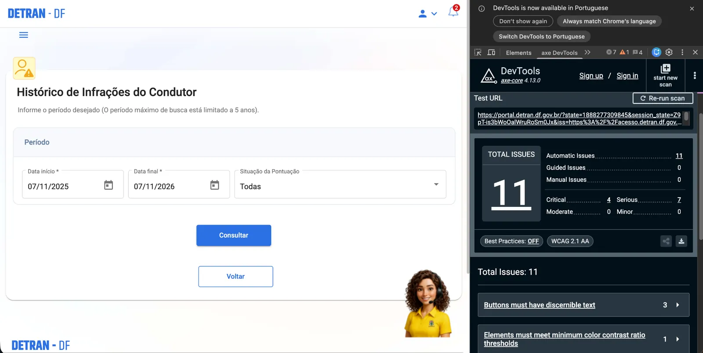{ loading=lazy }](../../assets/images/avaliacao-detran/fig-b39.webp){ target=_blank rel=noopener }
<figcaption markdown="1">**Fig. B39** · axe DevTools, E15 – Consulta de Infrações por Condutor</figcaption>
</figure>

<figure class="rel-fig" id="fig-b40" markdown="1">
[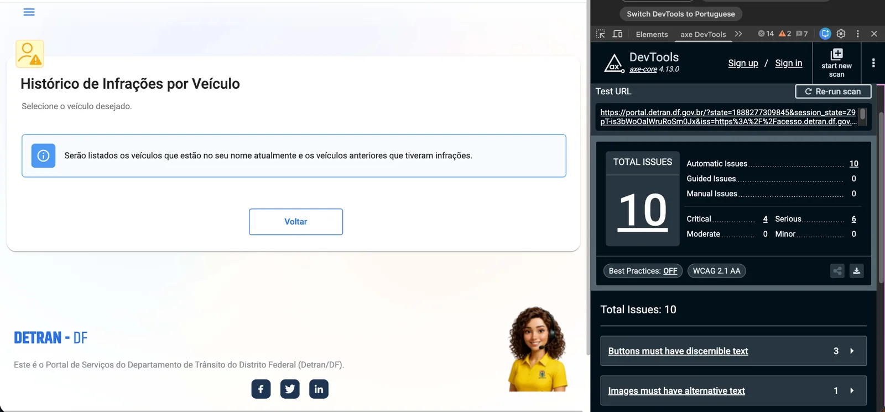{ loading=lazy }](../../assets/images/avaliacao-detran/fig-b40.webp){ target=_blank rel=noopener }
<figcaption markdown="1">**Fig. B40** · axe DevTools, E16 – Histórico de Infrações por Veículo</figcaption>
</figure>

<figure class="rel-fig" id="fig-b41" markdown="1">
[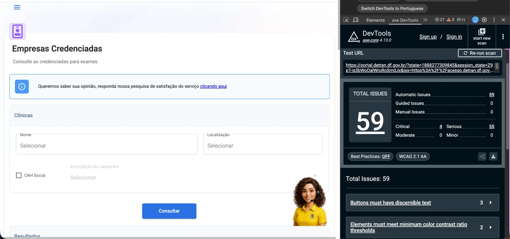{ loading=lazy }](../../assets/images/avaliacao-detran/fig-b41.webp){ target=_blank rel=noopener }
<figcaption markdown="1">**Fig. B41** · axe DevTools, E18 – Consultar Clínica</figcaption>
</figure>

<figure class="rel-fig" id="fig-b42" markdown="1">
[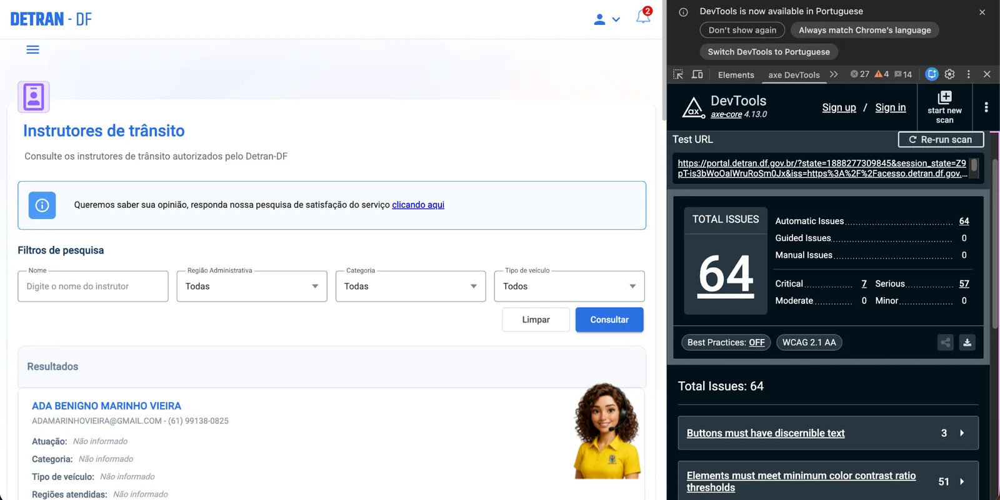{ loading=lazy }](../../assets/images/avaliacao-detran/fig-b42.webp){ target=_blank rel=noopener }
<figcaption markdown="1">**Fig. B42** · axe DevTools, E19 – Consultar Instrutores de Trânsito</figcaption>
</figure>

<figure class="rel-fig" id="fig-b43" markdown="1">
[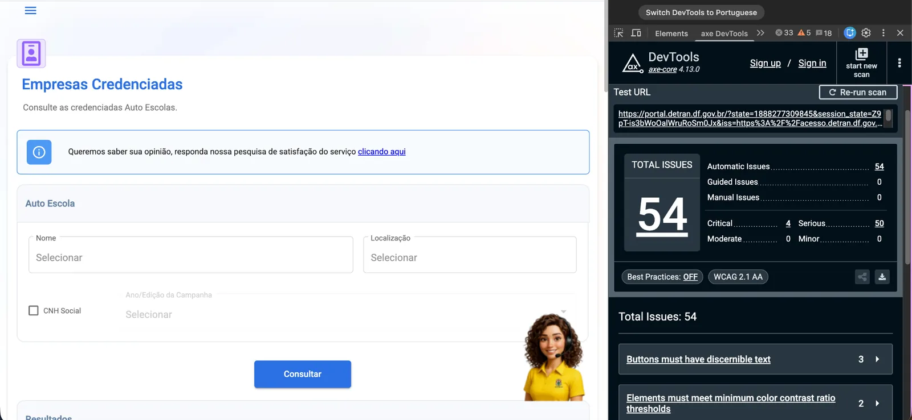{ loading=lazy }](../../assets/images/avaliacao-detran/fig-b43.webp){ target=_blank rel=noopener }
<figcaption markdown="1">**Fig. B43** · axe DevTools, E20 – Consultar Auto Escola</figcaption>
</figure>

<figure class="rel-fig" id="fig-b44" markdown="1">
[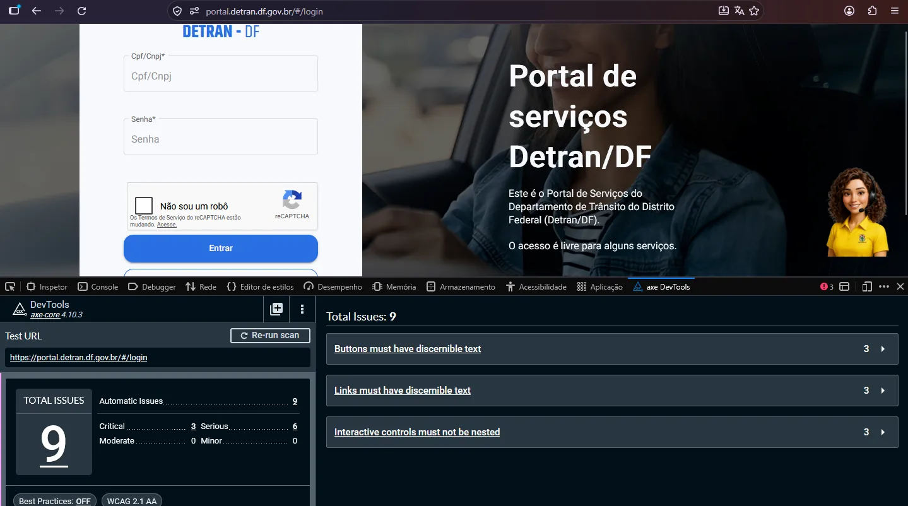{ loading=lazy }](../../assets/images/avaliacao-detran/fig-b44.webp){ target=_blank rel=noopener }
<figcaption markdown="1">**Fig. B44** · axe DevTools, E21 – Página de Login</figcaption>
</figure>

<figure class="rel-fig" id="fig-b45" markdown="1">
[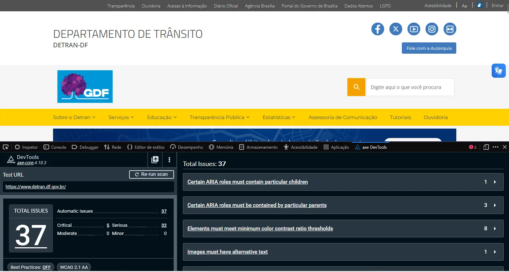{ loading=lazy }](../../assets/images/avaliacao-detran/fig-b45.webp){ target=_blank rel=noopener }
<figcaption markdown="1">**Fig. B45** · axe DevTools, E22 – Página Inicial 2</figcaption>
</figure>

