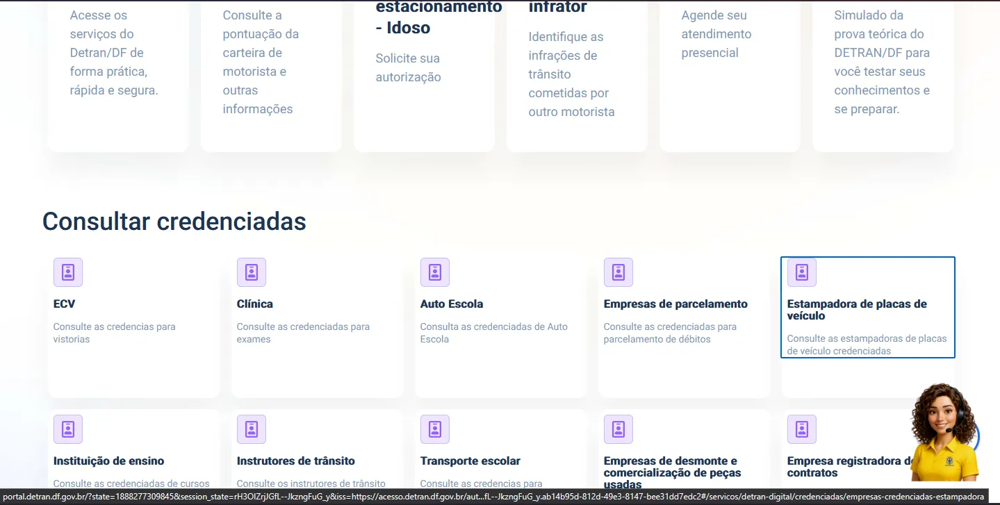
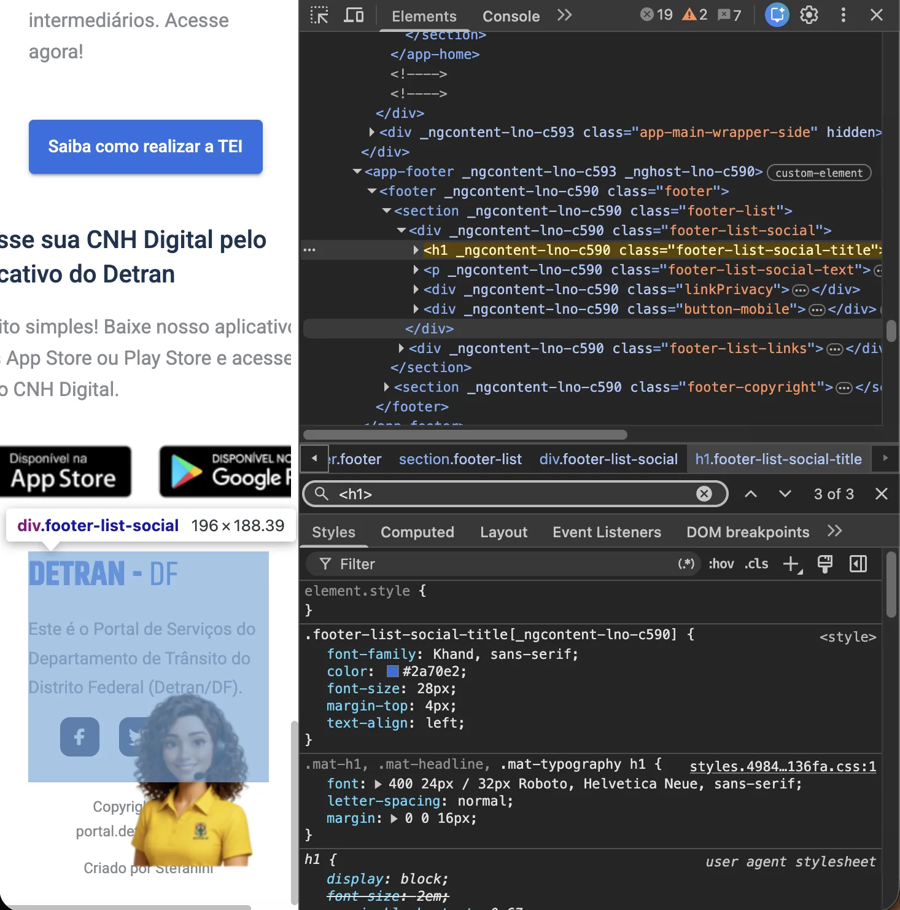
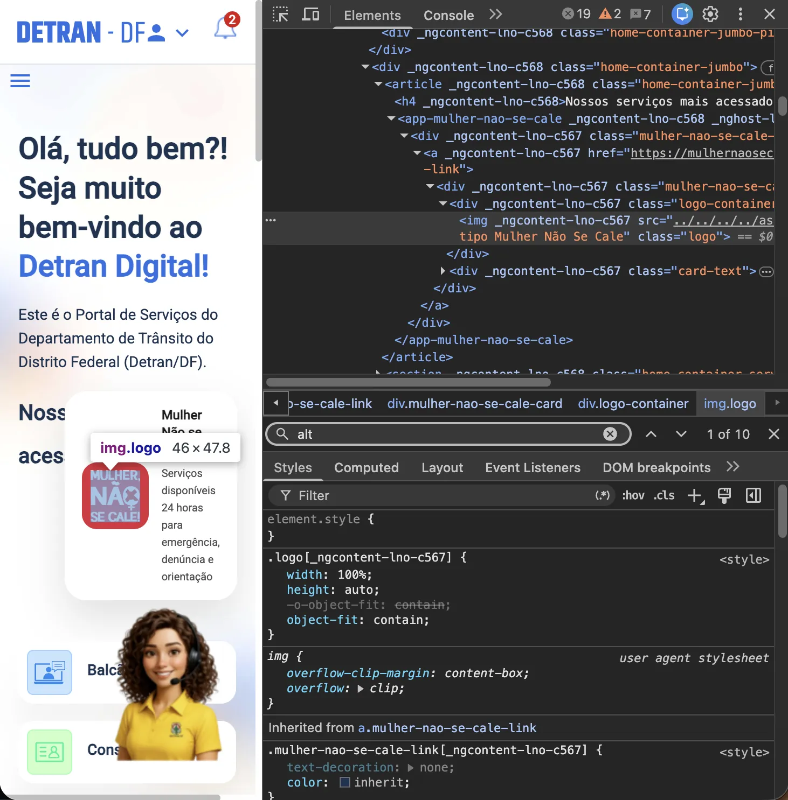
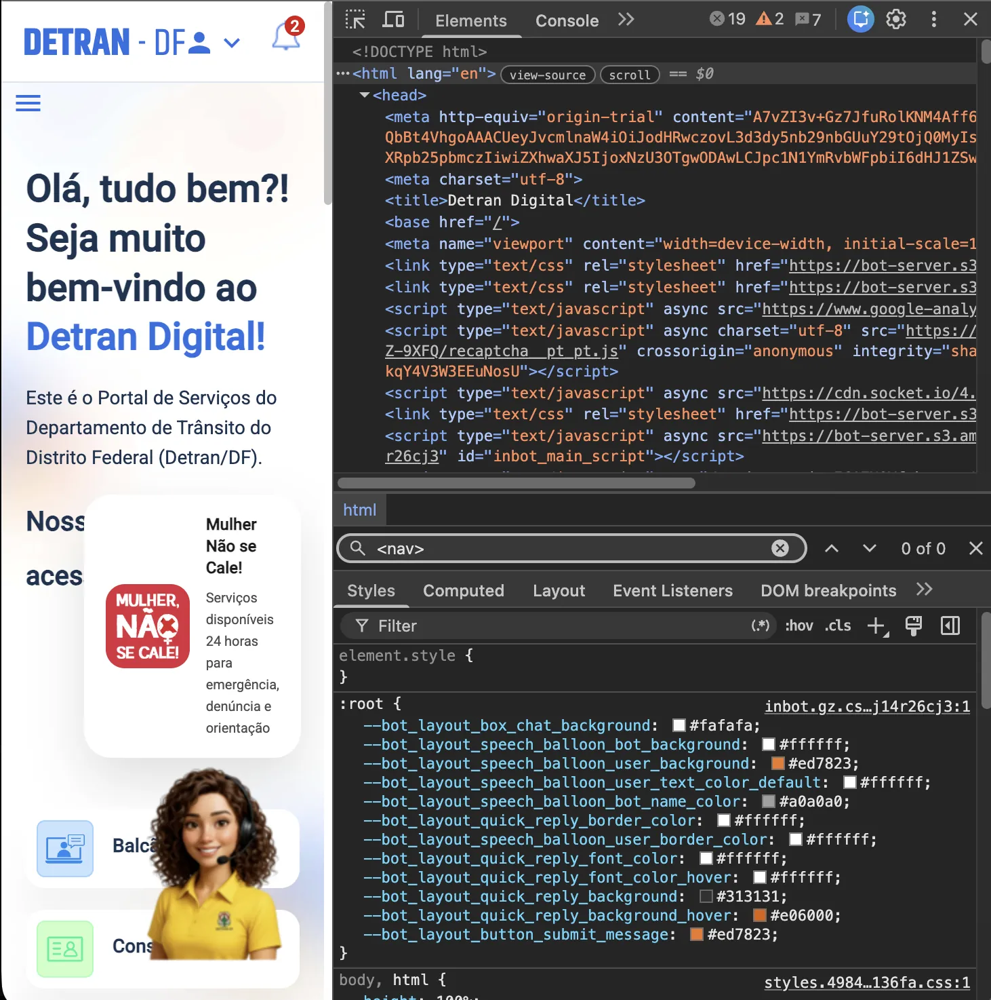
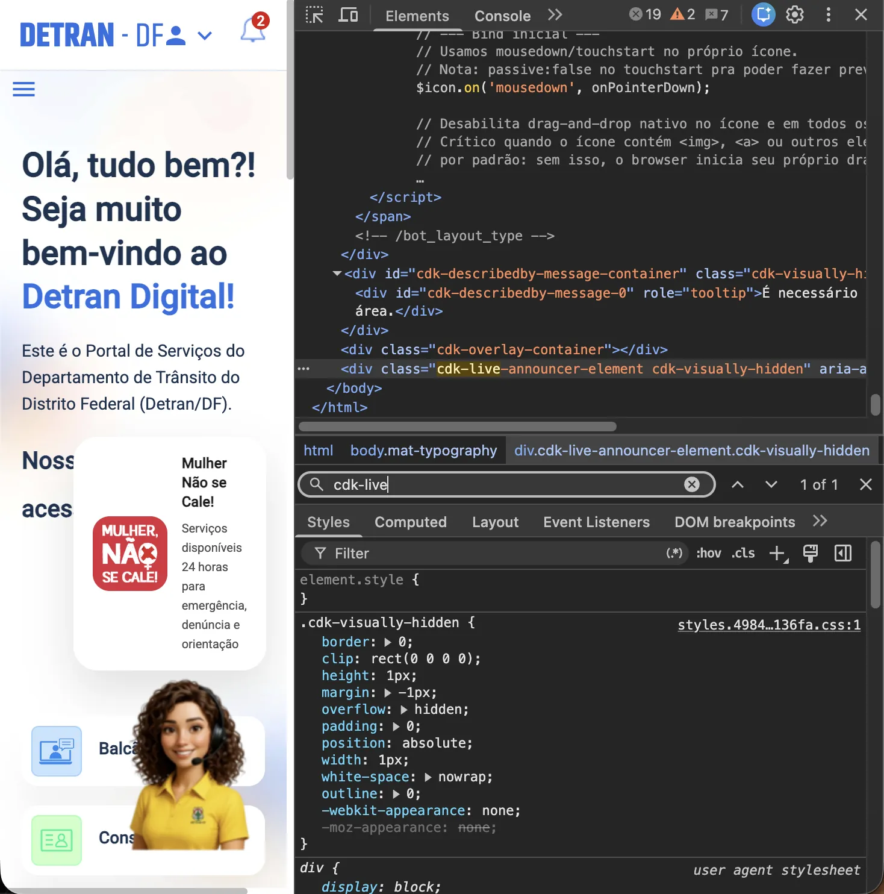
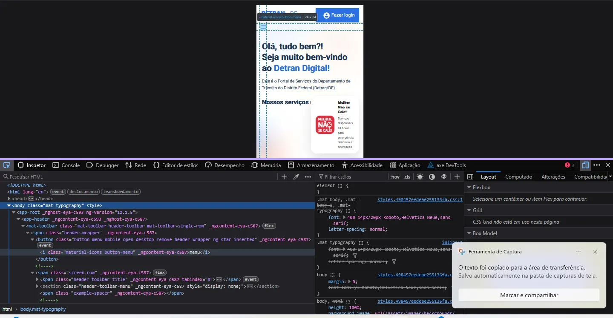
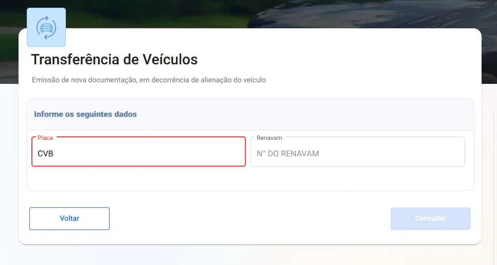

# Anexo C: evidências dos problemas

Capturas de tela da avaliação manual (C1 a C13) e dos problemas da [tabela de problemas](problemas.md) (C14 a C23). Clique em uma imagem para abri-la ampliada em outra aba.

## Verificações manuais (Fig. C1 a C13)

<figure class="rel-fig" id="fig-c1" markdown="1">
[{ loading=lazy }](../../assets/images/avaliacao-detran/fig-c1.webp){ target=_blank rel=noopener }
<figcaption markdown="1">**Fig. C1** · Teclado, Todas as funções acessíveis só com Tab, Enter e Espaço</figcaption>
</figure>

<figure class="rel-fig" id="fig-c2" markdown="1">
[{ loading=lazy }](../../assets/images/avaliacao-detran/fig-c2.webp){ target=_blank rel=noopener }
<figcaption markdown="1">**Fig. C2** · Teclado, Sem armadilha de foco</figcaption>
</figure>

<figure class="rel-fig" id="fig-c3" markdown="1">
[{ loading=lazy }](../../assets/images/avaliacao-detran/fig-c3.webp){ target=_blank rel=noopener }
<figcaption markdown="1">**Fig. C3** · Leitor de tela, Títulos e hierarquia de cabeçalhos</figcaption>
</figure>

<figure class="rel-fig" id="fig-c4" markdown="1">
[{ loading=lazy }](../../assets/images/avaliacao-detran/fig-c4.webp){ target=_blank rel=noopener }
<figcaption markdown="1">**Fig. C4** · Leitor de tela, Imagens com texto alternativo adequado</figcaption>
</figure>

<figure class="rel-fig" id="fig-c5" markdown="1">
[{ loading=lazy }](../../assets/images/avaliacao-detran/fig-c5.webp){ target=_blank rel=noopener }
<figcaption markdown="1">**Fig. C5** · Leitor de tela, Nome acessível em botões e links</figcaption>
</figure>

<figure class="rel-fig" id="fig-c6" markdown="1">
[{ loading=lazy }](../../assets/images/avaliacao-detran/fig-c6.webp){ target=_blank rel=noopener }
<figcaption markdown="1">**Fig. C6** · Leitor de tela, Landmarks e regiões da página</figcaption>
</figure>

<figure class="rel-fig" id="fig-c7" markdown="1">
[{ loading=lazy }](../../assets/images/avaliacao-detran/fig-c7.webp){ target=_blank rel=noopener }
<figcaption markdown="1">**Fig. C7** · Leitor de tela, Mensagens dinâmicas anunciadas</figcaption>
</figure>

<figure class="rel-fig" id="fig-c8" markdown="1">
[{ loading=lazy }](../../assets/images/avaliacao-detran/fig-c8.webp){ target=_blank rel=noopener }
<figcaption markdown="1">**Fig. C8** · Zoom e reflow, Zoom de 200% sem perda de conteúdo</figcaption>
</figure>

<figure class="rel-fig" id="fig-c9" markdown="1">
[{ loading=lazy }](../../assets/images/avaliacao-detran/fig-c9.webp){ target=_blank rel=noopener }
<figcaption markdown="1">**Fig. C9** · Zoom e reflow, Zoom de 400% sem rolagem horizontal</figcaption>
</figure>

<figure class="rel-fig" id="fig-c10" markdown="1">
[{ loading=lazy }](../../assets/images/avaliacao-detran/fig-c10.webp){ target=_blank rel=noopener }
<figcaption markdown="1">**Fig. C10** · Áreas de clique, Alvos com tamanho mínimo e espaçamento (principalmente no celular)</figcaption>
</figure>

<figure class="rel-fig" id="fig-c11" markdown="1">
[{ loading=lazy }](../../assets/images/avaliacao-detran/fig-c11.webp){ target=_blank rel=noopener }
<figcaption markdown="1">**Fig. C11** · Formulários, Rótulos visíveis e associados aos campos</figcaption>
</figure>

<figure class="rel-fig" id="fig-c12" markdown="1">
[{ loading=lazy }](../../assets/images/avaliacao-detran/fig-c12.webp){ target=_blank rel=noopener }
<figcaption markdown="1">**Fig. C12** · Formulários, Mensagens de erro claras e identificam o campo</figcaption>
</figure>

<figure class="rel-fig" id="fig-c13" markdown="1">
[{ loading=lazy }](../../assets/images/avaliacao-detran/fig-c13.webp){ target=_blank rel=noopener }
<figcaption markdown="1">**Fig. C13** · Formulários, Sugestão de correção</figcaption>
</figure>

## Problemas da tabela (Fig. C14 a C23)

<figure class="rel-fig" id="fig-c14" markdown="1">
[{ loading=lazy }](../../assets/images/avaliacao-detran/fig-c14.webp){ target=_blank rel=noopener }
<figcaption markdown="1">**Fig. C14** · Problema [P01](problemas.md#p01)</figcaption>
</figure>

<figure class="rel-fig" id="fig-c15" markdown="1">
[{ loading=lazy }](../../assets/images/avaliacao-detran/fig-c15.webp){ target=_blank rel=noopener }
<figcaption markdown="1">**Fig. C15** · Problema [P02](problemas.md#p02)</figcaption>
</figure>

<figure class="rel-fig" id="fig-c16" markdown="1">
[{ loading=lazy }](../../assets/images/avaliacao-detran/fig-c16.webp){ target=_blank rel=noopener }
<figcaption markdown="1">**Fig. C16** · Problema [P03](problemas.md#p03)</figcaption>
</figure>

<figure class="rel-fig" id="fig-c17" markdown="1">
[{ loading=lazy }](../../assets/images/avaliacao-detran/fig-c17.webp){ target=_blank rel=noopener }
<figcaption markdown="1">**Fig. C17** · Problema [P04](problemas.md#p04)</figcaption>
</figure>

<figure class="rel-fig" id="fig-c18" markdown="1">
[{ loading=lazy }](../../assets/images/avaliacao-detran/fig-c18.webp){ target=_blank rel=noopener }
<figcaption markdown="1">**Fig. C18** · Problema [P05](problemas.md#p05)</figcaption>
</figure>

<figure class="rel-fig" id="fig-c19" markdown="1">
[{ loading=lazy }](../../assets/images/avaliacao-detran/fig-c19.webp){ target=_blank rel=noopener }
<figcaption markdown="1">**Fig. C19** · Problema [P06](problemas.md#p06)</figcaption>
</figure>

<figure class="rel-fig" id="fig-c20" markdown="1">
[{ loading=lazy }](../../assets/images/avaliacao-detran/fig-c20.webp){ target=_blank rel=noopener }
<figcaption markdown="1">**Fig. C20** · Problema [P06](problemas.md#p06)</figcaption>
</figure>

<figure class="rel-fig" id="fig-c21" markdown="1">
[{ loading=lazy }](../../assets/images/avaliacao-detran/fig-c21.webp){ target=_blank rel=noopener }
<figcaption markdown="1">**Fig. C21** · Problema [P07](problemas.md#p07)</figcaption>
</figure>

<figure class="rel-fig" id="fig-c22" markdown="1">
[{ loading=lazy }](../../assets/images/avaliacao-detran/fig-c22.webp){ target=_blank rel=noopener }
<figcaption markdown="1">**Fig. C22** · Problema [P09](problemas.md#p09)</figcaption>
</figure>

<figure class="rel-fig" id="fig-c23" markdown="1">
[{ loading=lazy }](../../assets/images/avaliacao-detran/fig-c23.webp){ target=_blank rel=noopener }
<figcaption markdown="1">**Fig. C23** · Problema [P10](problemas.md#p10)</figcaption>
</figure>

