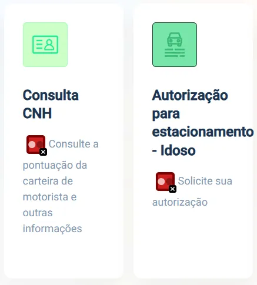
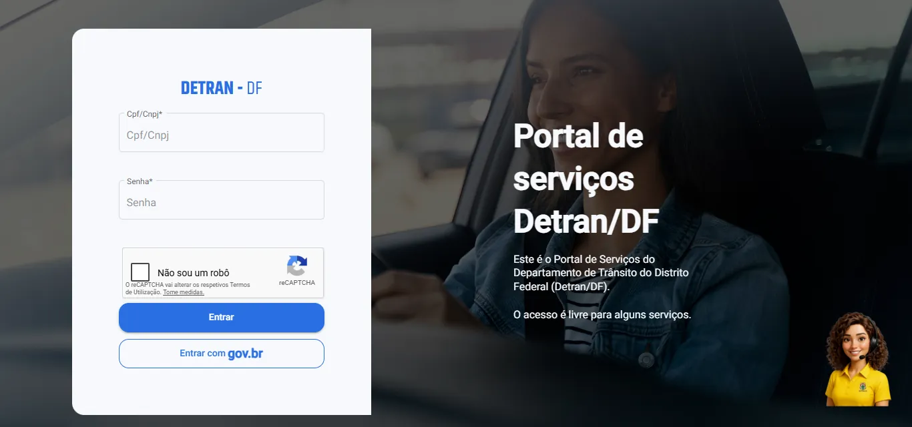
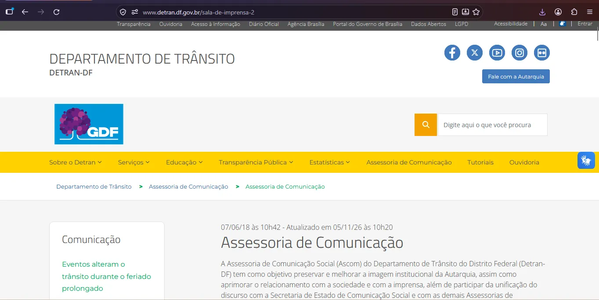
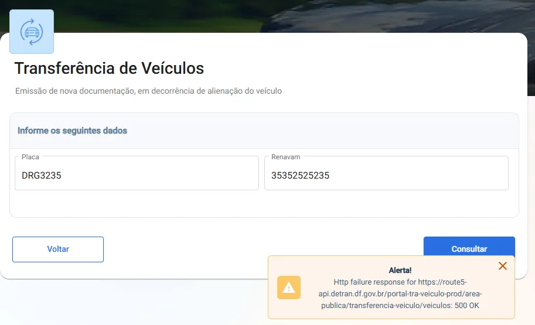
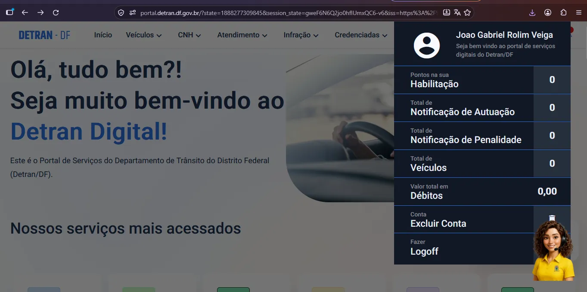
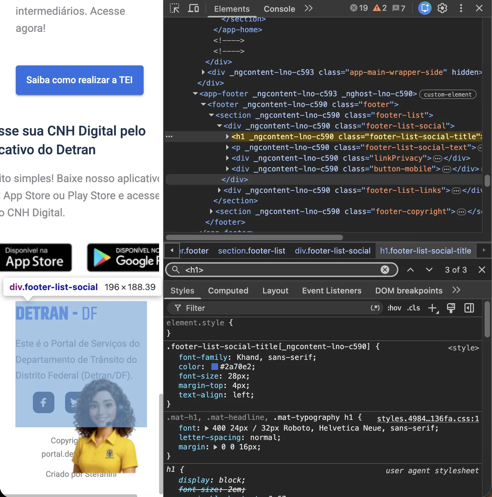
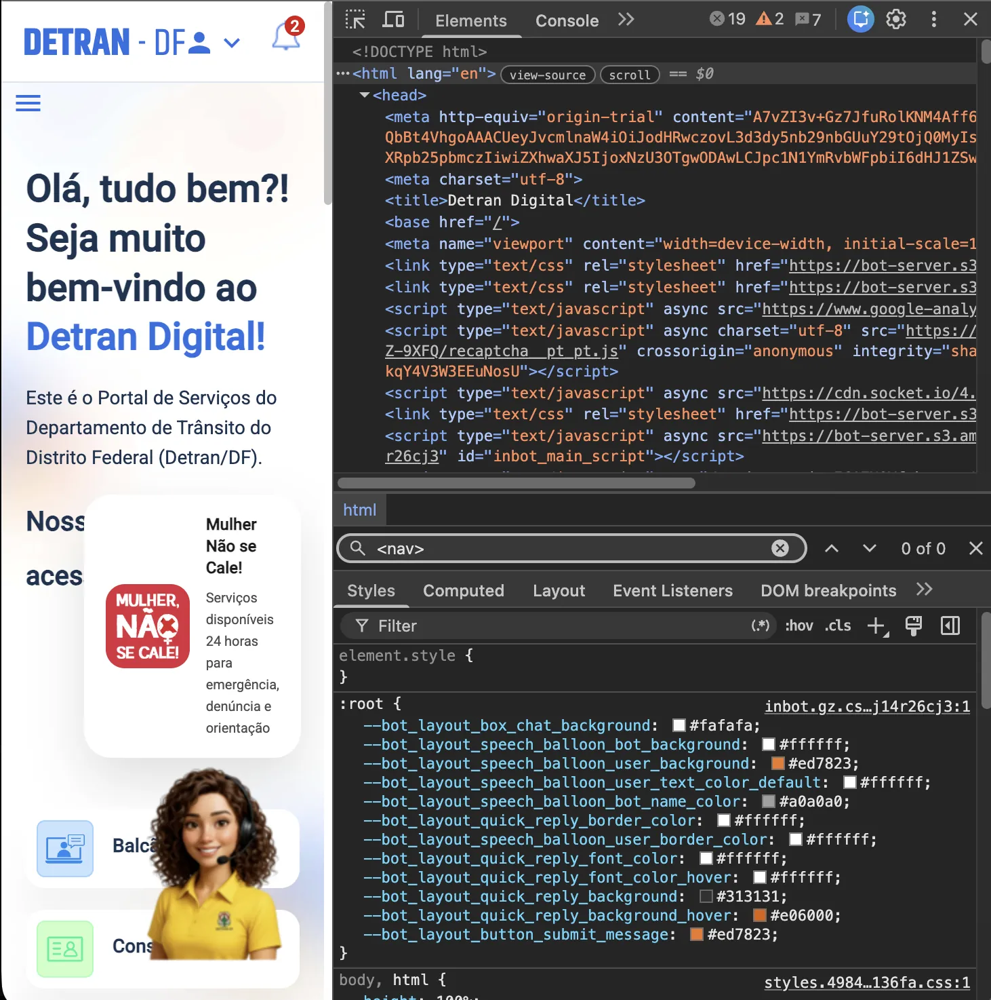
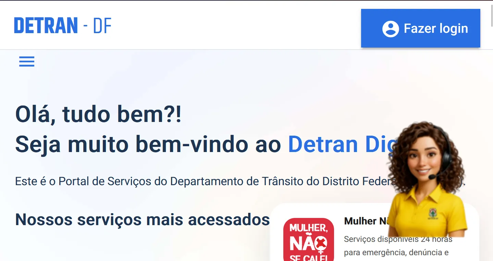

# Tabela de problemas

Foram registrados **14 problemas**. Cada um traz a página ou local, a evidência, a referência (WCAG, NBR, heurística de Nielsen ou ID do Guia), a severidade e a recomendação. A escala de severidade está em [Metodologia](metodologia.md#escala-de-severidade).

# Roteiro do Teste de Usabilidade

O roteiro de teste foi elaborado para orientar a avaliação da experiência de uma usuária real ao utilizar o Portal do Detran-DF.

Sua finalidade foi padronizar a apresentação dos cenários, definir os objetivos das tarefas, orientar a atuação dos avaliadores e estabelecer critérios para registrar os resultados observados durante a sessão.

O estudo contemplou **quatro cenários de uso**, relacionados a serviços de biometria, renovação da CNH, agendamento presencial e consulta de multas e pontuação.

## Objetivos do roteiro

O roteiro buscou investigar aspectos fundamentais da usabilidade:

- **Eficácia:** verificar se a participante conseguia alcançar os objetivos propostos.
- **Eficiência:** observar o tempo e o esforço necessários para realizar as tarefas.
- **Encontrabilidade:** investigar a facilidade de localizar serviços e informações.
- **Clareza:** avaliar se os caminhos de navegação e as orientações eram compreensíveis.
- **Satisfação:** compreender a percepção da participante após utilizar o sistema.

A avaliação foi complementada pela técnica *Think Aloud*, pelo questionário System Usability Scale (SUS) e por entrevistas realizadas antes e depois das tarefas.

## Organização da sessão

O procedimento foi organizado nas seguintes etapas:

1. **Acolhimento:** apresentação da atividade e esclarecimento de dúvidas.
2. **Consentimento:** leitura e assinatura do termo de participação.
3. **Entrevista inicial:** levantamento do perfil e da familiaridade com serviços digitais.
4. **Orientações:** explicação do Think Aloud e preparação para o teste.
5. **Execução das tarefas:** realização dos quatro cenários de uso.
6. **Questionário SUS:** registro da percepção de usabilidade.
7. **Entrevista final:** investigação das dificuldades e sugestões.
8. **Encerramento:** agradecimento e finalização da sessão.

O planejamento atualizado previa aproximadamente **32 minutos**, com duração máxima de 45 minutos.

### Orientações para os avaliadores

Durante a execução das tarefas, a equipe deveria apresentar os cenários sem indicar antecipadamente os caminhos de navegação.

A participante foi incentivada a verbalizar seus pensamentos, expectativas e dificuldades.

Os avaliadores poderiam utilizar estímulos neutros, como:

- “Continue falando.”
- “O que está pensando agora?”

Orientações capazes de indicar o caminho para resolver a tarefa deveriam ser registradas como intervenções.

Nenhuma tarefa exigia a inserção ou o envio de dados pessoais reais.

## Cenários de avaliação

### T01 — Localização de postos de atendimento

**Contexto:** a participante precisava encontrar um local para realizar a coleta biométrica presencial.

> Você precisa ir pessoalmente ao Detran-DF para fazer uma biometria. Encontre um local onde isso possa ser resolvido e descubra o endereço e o horário de funcionamento.

| Elemento | Descrição |
|---|---|
| Ponto de partida | Página inicial do portal institucional |
| Objetivo | Localizar informações oficiais de atendimento para biometria |
| Critério de sucesso | Encontrar a página de postos e identificar informações de endereço e horário |
| Tempo de referência do ensaio | 30 segundos |
| Limite consolidado | 120 segundos |

**Caminho de referência:** página inicial → biometria → postos de atendimento → informações de unidades, endereços e horários.

**Resultado observado:** tarefa concluída sem ajuda, em aproximadamente 25 segundos. A participante acessou a página coletiva de postos, sem selecionar verbalmente uma unidade específica.

### T02 — Renovação da CNH

**Contexto:** a participante precisava encontrar orientações oficiais para renovar sua Carteira Nacional de Habilitação.

> Sua CNH está próxima do vencimento. Encontre as orientações oficiais para renová-la no Distrito Federal.

| Elemento | Descrição |
|---|---|
| Ponto de partida | Página inicial do portal institucional |
| Objetivo | Localizar orientações sobre renovação da CNH |
| Critério de sucesso | Acessar orientações oficiais e identificar coleta biométrica e exame médico |
| Tempo de referência do ensaio | 60 segundos |
| Limite consolidado | 160 segundos |

**Caminho de referência:** página inicial → pesquisa por renovação da CNH → orientações oficiais de habilitação → identificação dos procedimentos.

**Resultado observado:** a participante iniciou a procura pelo Detran Digital e precisou retornar ao portal institucional.

O limite analítico de 160 segundos foi atingido sem a conclusão da tarefa. A busca continuou até aproximadamente 351 segundos de gravação, quando as orientações foram encontradas.

Por esse motivo, a tarefa foi classificada como **não concluída dentro do limite considerado**.

### T03 — Agendamento de atendimento presencial

**Contexto:** a participante precisava demonstrar como iniciaria o agendamento de um atendimento presencial.

> Você precisa de atendimento presencial no Detran-DF e quer garantir dia e horário. Mostre como começaria a marcar esse atendimento pelo site, sem concluir a marcação.

| Elemento | Descrição |
|---|---|
| Ponto de partida | Página inicial do portal institucional |
| Objetivo | Localizar e iniciar o fluxo de agendamento |
| Critério de sucesso | Acessar o formulário ou a etapa inicial de agendamento |
| Tempo de referência do ensaio | 30 segundos |
| Limite consolidado | 120 segundos |

**Caminho de referência:** página inicial → Detran Digital → agendamento presencial → formulário inicial.

**Resultado observado:** tarefa concluída sem ajuda, em aproximadamente 115 segundos.

Houve uma releitura do cenário durante a execução, mas ela não indicou um caminho de navegação e não foi contabilizada como ajuda para alcançar o objetivo.

### T04 — Consulta de multas e pontuação

**Contexto:** a participante precisava identificar onde consultar possíveis multas ou pontos associados à habilitação ou ao veículo.

> Você quer saber se existe alguma multa ou pontos na sua carteira ou no seu carro. Descubra como consultar isso pelo site, sem digitar seus dados.

| Elemento | Descrição |
|---|---|
| Ponto de partida | Página inicial do portal institucional |
| Objetivo | Localizar o acesso à consulta de infrações ou pontuação |
| Critério de sucesso | Exibir a tela de consulta, sem inserir dados pessoais |
| Tempo de referência do ensaio | 40 segundos |
| Limite consolidado | 140 segundos |

**Caminho de referência:** página inicial → Detran Digital → Infrações → consulta correspondente.

**Resultado observado:** tarefa concluída com uma dica de navegação, em aproximadamente 66 segundos.

A intervenção orientou a participante a retornar ao início do Detran Digital para localizar o serviço.

## Critérios de classificação

Os resultados foram organizados em três categorias:

| Classificação | Significado |
|---|---|
| **Sucesso sem ajuda** | A participante alcança o objetivo sem dicas de navegação |
| **Sucesso com ajuda** | A participante alcança o objetivo com uma dica de navegação |
| **Falha** | A tarefa não atende aos critérios definidos, é concluída incorretamente, ultrapassa o limite ou exige intervenções além do permitido |

Além do desfecho, foram registrados tempos, intervenções, erros e comportamentos observados.

!!! note "Sobre os critérios"
    Os limites e determinados critérios foram consolidados na revisão final do estudo. O relatório não comprova que todos os limites definitivos tenham sido formalmente fixados antes da sessão.

## Tempos e resultados observados

| Tarefa | Tempo considerado | Resultado |
|---|---:|---|
| T01 — Biometria | ≈25 s | Sucesso sem ajuda |
| T02 — Renovação da CNH | 160 s | Falha no limite |
| T03 — Agendamento | ≈115 s | Sucesso sem ajuda |
| T04 — Multas e pontuação | ≈66 s | Sucesso com ajuda |

Na T02, os 160 segundos representam o limite utilizado na análise, não a duração total da procura. A participante continuou a tarefa após esse marco.

## Entrevistas e questionário SUS

### Entrevista inicial

A entrevista inicial buscou compreender a familiaridade da participante com a internet, os dispositivos utilizados e sua experiência com serviços públicos digitais.

As informações contribuíram para contextualizar os comportamentos observados durante o teste.

### Questionário SUS

Após a execução das tarefas, foi aplicado o questionário **System Usability Scale**, composto por dez afirmações.

O questionário permite obter uma pontuação padronizada sobre a percepção de usabilidade, complementando as observações realizadas durante a sessão.

### Entrevista final

A entrevista final investigou a percepção da participante sobre as tarefas, os serviços encontrados e as dificuldades enfrentadas.

Entre os assuntos destacados estiveram:

- Dificuldade para localizar orientações de renovação da CNH.
- Necessidade de mecanismos de busca mais evidentes.
- Maior destaque para serviços utilizados frequentemente.
- Dificuldades decorrentes de novas autenticações entre os portais.

Essas informações contribuíram para a elaboração das recomendações de melhoria.

## Visão geral

| ID | Problema | Página / local | Severidade | Evidência |
|----|----------|----------------|:----------:|-----------|
| [P01](#p01) | Contraste insuficiente nos serviços mais acessados | E1 – Página Inicial | Moderado | Fig. C14 |
| [P02](#p02) | Imagens de aplicativos sem texto alternativo | E1 – Página Inicial | Crítico | Fig. C15 |
| [P03](#p03) | Campo de formulário sem rótulo | E1 – Página Inicial | Grave | Fig. C16 |
| [P04](#p04) | Botões sem nome acessível | E1 – Página Inicial | Crítico | Fig. C17 |
| [P05](#p05) | Possível loop de autenticação com o gov.br | E21 – Página de Login do Detran Digital | Crítico | Fig. C18 |
| [P06](#p06) | Inconsistência visual entre o portal e o Detran Digital | E1 (Página Inicial do Portal do Detran-DF) e E21/E22 (Detran Digital) | Moderado | Fig. C19, Fig. C23 |
| [P07](#p07) | Mensagens de erro genéricas em formulários | E7 – Página de Transferência de Veículo no Detran Digital | Moderado | Fig. C21 |
| [P08](#p08) | Renovação de CNH difícil de encontrar | E1 – Página Principal do Detran Digital | Crítico | — |
| [P09](#p09) | Logoff sem confirmação | E1 – Página Inicial do Detran Digital | Leve | Fig. C22 |
| [P10](#p10) | FAQ ausente ou pouco visível no portal | E22 – Página Inicial do Detran-DF | Moderado | Fig. C23 |
| [P11](#p11) | Transferência de veículo sem opção de desfazer | E7 – Página de Transferência de Veículo | Moderado | Fig. C21 |
| [P12](#p12) | Falha na hierarquia de títulos e cabeçalhos | E1, E14 e E21 | Grave | [Fig. C3](../../assets/images/avaliacao-detran/fig-c3.webp) |
| [P13](#p13) | Regiões da página (landmarks) ausentes ou inadequadas | E1, E14, E18–E21 | Grave | [Fig. C6](../../assets/images/avaliacao-detran/fig-c6.webp) |
| [P14](#p14) | Perda de conteúdo e rolagem horizontal com ampliação | Todas as páginas avaliadas | Grave | [Fig. C8](../../assets/images/avaliacao-detran/fig-c8.webp), [Fig. C9](../../assets/images/avaliacao-detran/fig-c9.webp) |

## Detalhamento

### P01 · Contraste insuficiente nos serviços mais acessados {#p01}

Moderado

Os textos descritivos da seção “serviços mais acessados” apresentam contraste insuficiente em relação à cor de fundo.

OndeE1 – Página Inicial

ReferênciaWCAG 1.4.3, Guia DES-02 (contraste mínimo) e HU-h2

EvidênciaFig. C14

**Recomendação.** Alterar a cor do texto para um tom mais contrastante com o fundo, de preferência um tom mais escuro.

<figure class="prob-fig" markdown="1">
{ loading=lazy }
<figcaption markdown="1">**Fig. C14** · Evidência de P01.</figcaption>
</figure>

### P02 · Imagens de aplicativos sem texto alternativo {#p02}

Crítico

Imagens que levam à plataforma de aplicativos mobile não possuem opção de texto alternativo.

OndeE1 – Página Inicial

ReferênciaWCAG 1.1.1, WCAG 2.4.4, Guia DEV-02 e CON-12

EvidênciaFig. C15

**Recomendação.** Inserir texto alternativo (`alt`) na imagem que descreva claramente o destino ou a ação do link (ex.: `alt="Acessar serviços de Habilitação"`), e não apenas o que a imagem é.

<figure class="prob-fig" markdown="1">
{ loading=lazy }
<figcaption markdown="1">**Fig. C15** · Evidência de P02.</figcaption>
</figure>

### P03 · Campo de formulário sem rótulo {#p03}

Grave

Campo de formulário (como o de busca ou login) não possui um rótulo associado.

OndeE1 – Página Inicial

ReferênciaWCAG 1.3.1 (Informações e Relações), WCAG 3.3.2 (Rótulos ou Instruções), Guia DEV-14

EvidênciaFig. C16

**Recomendação.** Associar um elemento `<label>` válido ao campo `<input>` através dos atributos `for` e `id`, ou utilizar `aria-label` caso o layout não permita um rótulo visual.

<figure class="prob-fig" markdown="1">
{ loading=lazy }
<figcaption markdown="1">**Fig. C16** · Evidência de P03.</figcaption>
</figure>

### P04 · Botões sem nome acessível {#p04}

Crítico

Botões não possuem texto explicativo de suas funções.

OndeE1 – Página Inicial

ReferênciaWCAG 4.1.2 (link para as redes sociais), Guia DEV-11 e DEV-01

EvidênciaFig. C17

**Recomendação.** Adicionar texto descritivo no interior da tag `<button>`. Se o botão utilizar apenas um ícone visual, deve-se adicionar o atributo `aria-label="[Ação do botão]"`.

<figure class="prob-fig" markdown="1">
{ loading=lazy }
<figcaption markdown="1">**Fig. C17** · Evidência de P04.</figcaption>
</figure>

### P05 · Possível loop de autenticação com o gov.br {#p05}

Crítico

Possibilidade de loop de autenticação em relação à integração gov.br no Detran Digital.

OndeE21 – Página de Login do Detran Digital

ReferênciaWCAG 4.1.3 (Mensagens de Status, AA), Guia DEV-10 e HU-a1

EvidênciaFig. C18

**Recomendação.** Resolver os problemas de integração da plataforma gov.br com o Detran Digital.

<figure class="prob-fig" markdown="1">
{ loading=lazy }
<figcaption markdown="1">**Fig. C18** · Evidência de P05.</figcaption>
</figure>

### P06 · Inconsistência visual entre o portal e o Detran Digital {#p06}

Moderado

Inconsistência visual entre o site principal do Detran-DF e o Detran Digital.

OndeE1 (Página Inicial do Portal do Detran-DF) e E21/E22 (Detran Digital)

ReferênciaWCAG 3.2.3 (Navegação Consistente, AA), Guia DES-06, HU-d1 e HU-d3

EvidênciaFig. C19, Fig. C23

**Recomendação.** Integrar as características visuais das duas páginas a fim de encontrar uma solução visual consistente e lógica.

<figure class="prob-fig" markdown="1">
{ loading=lazy }
<figcaption markdown="1">**Fig. C19** · Evidência de P06.</figcaption>
</figure>

<figure class="prob-fig" markdown="1">
{ loading=lazy }
<figcaption markdown="1">**Fig. C23** · Evidência de P06.</figcaption>
</figure>

### P07 · Mensagens de erro genéricas em formulários {#p07}

Moderado

Alguns formulários não indicam causas de erro de preenchimento e retornam mensagens genéricas de erro.

OndeE7 – Página de Transferência de Veículo no Detran Digital

ReferênciaWCAG 3.3.1 (Identificação do Erro, A), Guia DEV-16, HU-i1 e HU-i3

EvidênciaFig. C21

**Recomendação.** Adicionar textos auxiliares de explicações de erros de preenchimento nos campos de formulários com esse problema.

<figure class="prob-fig" markdown="1">
{ loading=lazy }
<figcaption markdown="1">**Fig. C21** · Evidência de P07.</figcaption>
</figure>

### P08 · Renovação de CNH difícil de encontrar {#p08}

Crítico

Ao pesquisar como renovar a CNH no Detran Digital, encontra-se uma ata informando que a renovação é efetuada diretamente pelo portal, porém a opção não foi encontrada.

OndeE1 – Página Principal do Detran Digital

ReferênciaWCAG 2.4.5 (Várias Formas, AA), Guia HU-d3

EvidênciaO relatório não traz figura para este item. Veja o teste T02 na [seção 9](teste-usuario.md).

**Recomendação.** Deixar a opção bem explícita no menu de serviços do Detran Digital.

### P09 · Logoff sem confirmação {#p09}

Leve

A opção de Logoff na plataforma do Detran Digital não exige confirmação do usuário.

OndeE1 – Página Inicial do Detran Digital

ReferênciaGuia HU-e1

EvidênciaFig. C22

**Recomendação.** Inserir uma mensagem de confirmação na operação de logoff.

<figure class="prob-fig" markdown="1">
{ loading=lazy }
<figcaption markdown="1">**Fig. C22** · Evidência de P09.</figcaption>
</figure>

### P10 · FAQ ausente ou pouco visível no portal {#p10}

Moderado

O Portal não possui uma aba de FAQ ou Perguntas Frequentes clara e de fácil acesso.

OndeE22 – Página Inicial do Detran-DF

ReferênciaGuia HU-j1

EvidênciaFig. C23

**Recomendação.** Se houver uma seção correspondente, deixá-la visível e devidamente contrastada em todas as páginas associadas.

<figure class="prob-fig" markdown="1">
{ loading=lazy }
<figcaption markdown="1">**Fig. C23** · Evidência de P10.</figcaption>
</figure>

### P11 · Transferência de veículo sem opção de desfazer {#p11}

Moderado

A Transferência de Veículo não tem um recurso claro de “Desfazer” ou de cancelar a operação.

OndeE7 – Página de Transferência de Veículo

ReferênciaHU-c1

EvidênciaFig. C21

**Recomendação.** Oferecer opção de desfazer ou cancelar a solicitação, com confirmação do resultado.

<figure class="prob-fig" markdown="1">
{ loading=lazy }
<figcaption markdown="1">**Fig. C21** · Evidência de P07.</figcaption>
</figure>

### P12 · Falha na hierarquia de títulos e cabeçalhos {#p12}

Grave

Estrutura de títulos e cabeçalhos (de `h1` a `h6`) inconsistente, dificultando compreender a organização da página e navegar por títulos com leitor de tela.

OndeE1, E14 e E21

ReferênciaWCAG 1.3.1 e 2.4.6; Guia DEV-04

**Recomendação.** Organizar títulos de forma lógica, com níveis que representem as seções e descrições claras, evitando saltos que prejudiquem a estrutura compreendida por tecnologias assistivas.

<figure class="prob-fig" markdown="1">
{ loading=lazy }
<figcaption markdown="1">**Fig. C3** · Evidência de P12 registrada no relatório de avaliação.</figcaption>
</figure>

### P13 · Regiões da página inadequadas {#p13}

Grave

Ausência ou marcação inadequada de regiões da página (*landmarks* HTML5/ARIA), que dificulta saltar diretamente para navegação, conteúdo principal ou rodapé por leitores de tela.

OndeE1, E14, E18, E19, E20 e E21

ReferênciaWCAG 1.3.1; Guia DEV-01

**Recomendação.** Utilizar regiões semânticas como `header`, `nav`, `main` e `footer` e, quando necessário, atributos ARIA equivalentes, sem criar regiões redundantes.

<figure class="prob-fig" markdown="1">
{ loading=lazy }
<figcaption markdown="1">**Fig. C6** · Evidência de P13 registrada no relatório de avaliação.</figcaption>
</figure>

### P14 · Zoom e reflow insuficientes {#p14}

Grave

Foi relatada perda de conteúdo a 200% de zoom e necessidade de rolagem horizontal a 400%, comprometendo o uso por pessoas com baixa visão.

OndePáginas avaliadas no relatório

ReferênciaWCAG 1.4.4 e 1.4.10; Guia DES-01 e DES-04

**Recomendação.** Utilizar layout responsivo com unidades flexíveis e adaptação do conteúdo para preservar sua leitura e operação em ampliação, observadas as exceções dos critérios aplicáveis.

<figure class="prob-fig" markdown="1">
{ loading=lazy }
<figcaption markdown="1">**Fig. C8** · Evidência de P14.</figcaption>
</figure>
<figure class="prob-fig" markdown="1">
{ loading=lazy }
<figcaption markdown="1">**Fig. C9** · Evidência complementar de P14.</figcaption>
</figure>

